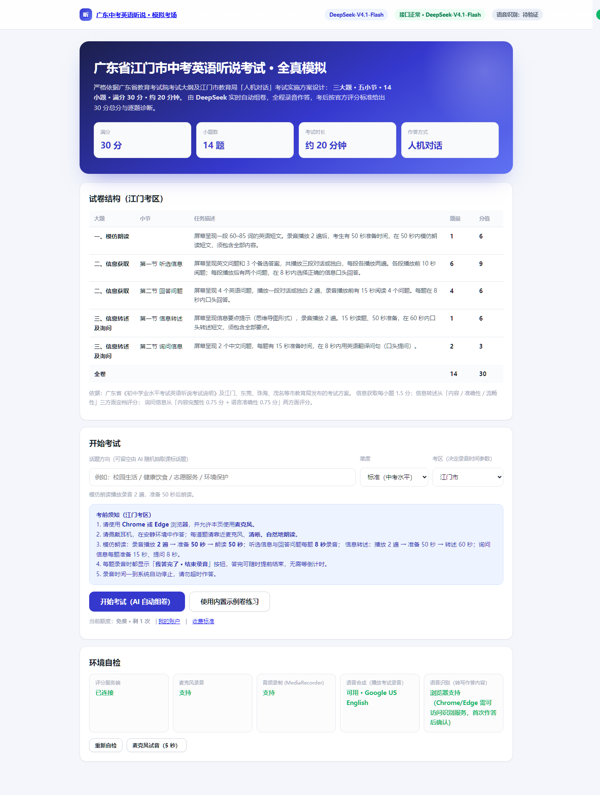
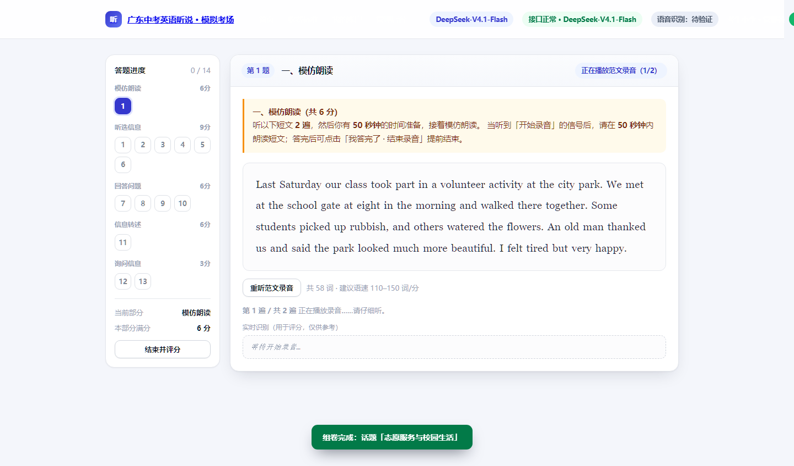
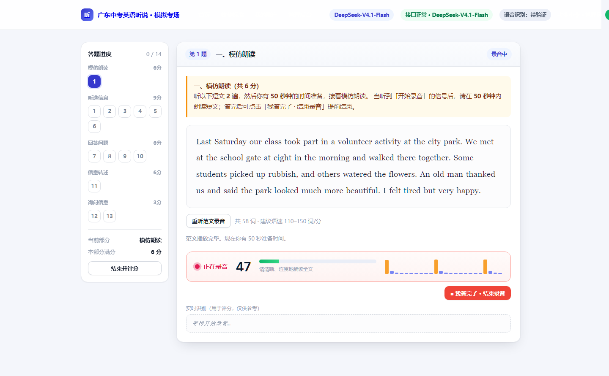
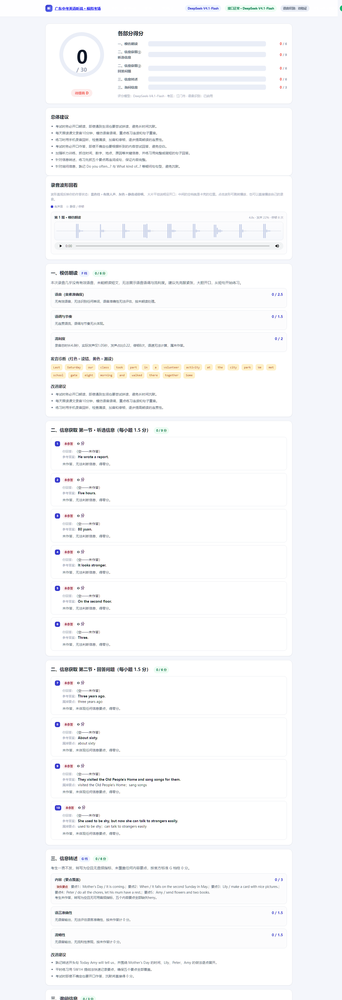
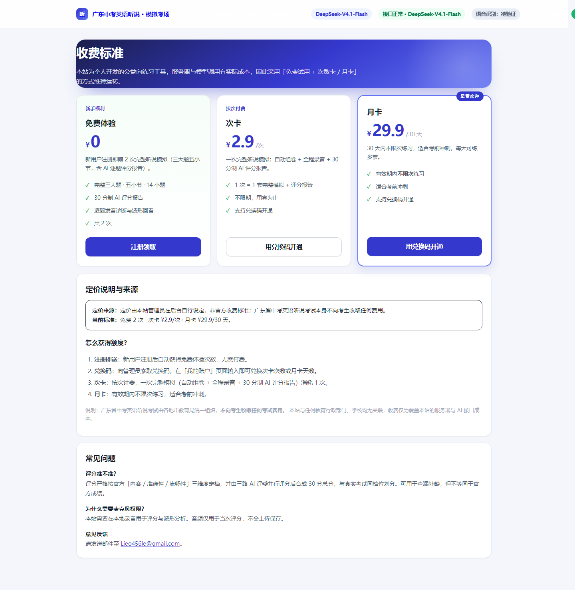
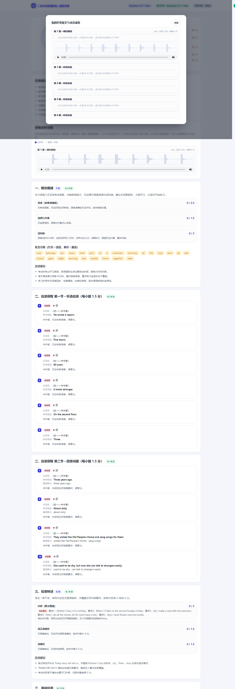
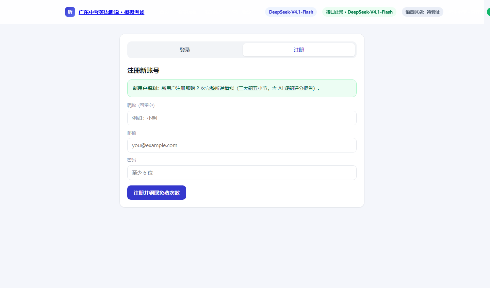
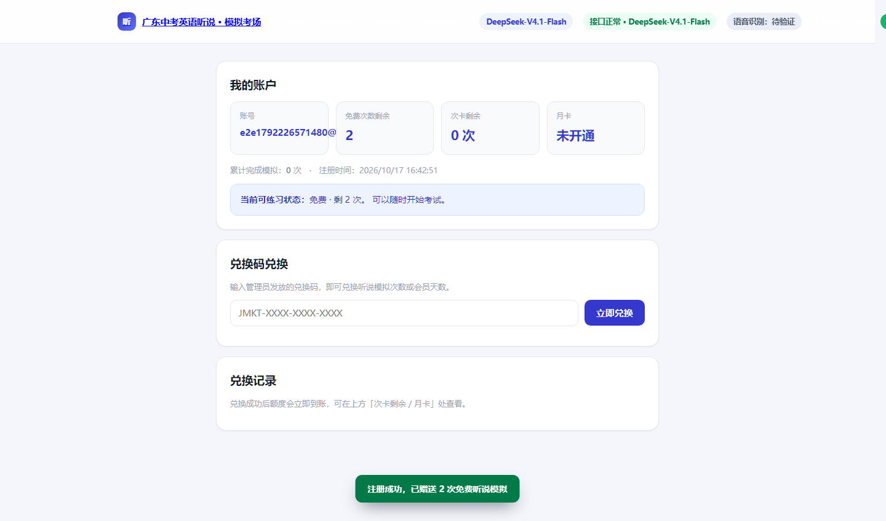
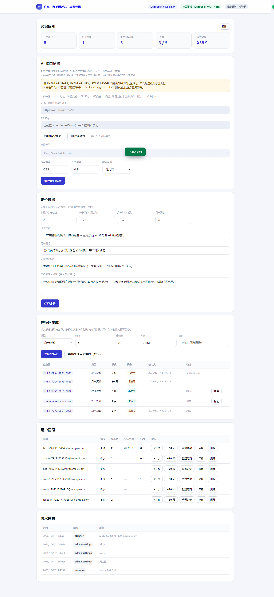

<div align="center">

# 广东中考英语听说 · 在线模拟考场

**严格按照广东省江门市中考英语听说考试（人机对话）官方题型与评分标准设计**

三大题 · 五小节 · 14 小题 · 满分 30 分 · 约 20 分钟

AI 自动组卷 ｜ 全程录音作答 ｜ 30 分制智能评分 ｜ 逐题波形回看

[功能特性](#-功能特性) · [试卷结构](#-试卷结构) · [快速开始](#-快速开始) · [部署上线](#-部署到-railway) · [管理后台](#-管理后台) · [想法来源](#-这个项目是怎么来的)

</div>

---

## 📸 界面预览

| 首页 · 试卷结构 | 考试中 · 模仿朗读 |
| :---: | :---: |
|  |  |

| 录音作答中（含实时识别与音量表） | 成绩报告 · 30 分制 |
| :---: | :---: |
|  |  |

| 收费标准（管理员可自定义） | 作答原文与录音波形 |
| :---: | :---: |
|  |  |

| 注册 / 登录 | 我的账户（兑换码） |
| :---: | :---: |
|  |  |

| 管理员后台 · 接口配置与兑换码 |
| :---: |
|  |

> 💡 截图由无头 Chrome 自动生成（见 `scratch/browser-e2e.mjs`），保证与代码真实一致。

---

## 🎯 这个项目是怎么来的

### 缘起

我在**江门**读初中，英语听说考试占中考英语总分的 **30 分**（满分 120 分中的 30 分），权重非常高。
但备考时我发现一个很实际的问题：

- **学校机房练习机会太少** —— 一个学期能上机模拟的次数屈指可数；
- **市面上的 App 都要付费**，而且很多是外省题型，跟广东的"人机对话"模式对不上；
- **练完不知道自己错在哪** —— 只给一个分数，不告诉你哪个单词读错了、哪个要点漏了；
- **最关键的是：没有人告诉你"时间到了该停"还是"你还有时间"** —— 而考试的失分点往往就在节奏上。

于是我萌生了一个想法：**能不能用 AI 做一个"随时能练、和真考试一模一样、考完还告诉你错在哪"的模拟考场？**

### 为什么是这套结构

广东省中考英语听说考试在不同年份、由不同地市组织过 `三大题五小节` 与 `五大题` 两种表述，但**分值构成是完全一致的**：

```
模仿朗读 6 分 + 听选信息 9 分 + 回答问题 6 分 + 信息转述 6 分 + 询问信息 3 分 = 30 分
```

本项目采用**全省统一的 30 分构成**，并按**江门考区的录音时间参数**编排（可一键切换广州/佛山/珠海/东莞/茂名/清远等考区）。

### 设计上的几个取舍

| 问题 | 我的选择 | 原因 |
| :--- | :--- | :--- |
| 题目从哪来？ | **AI 实时组卷**（DeepSeek） | 每次都是新题，不会"背答案"；话题取自课标范围，可自选方向与难度 |
| 怎么评分？ | **三路 AI 评委并行 + 服务端算术校准** | 模仿朗读/信息获取/转述询问各自独立评分，再由服务端强制合计为 30 分，避免 AI 算错加法 |
| 没有 ASR 怎么办？ | **浏览器语音识别 + 三级降级** | 主用 Web Speech API 转写；不可用时自动降级为"纯声学评分"（依据流利度/语速/发声时长/停顿），并在 UI 明确标注 |
| 怎么让人看到"哪里卡住了"？ | **录音波形图** | 直接用录音时采集的 RMS 电平画包络，不依赖音频解码，蓝色＝人声、灰色＝停顿，卡壳位置一目了然 |
| 怎么防止 AI 组卷失败导致没法考？ | **混合兜底** | AI 若失败，自动用内置高质量示例卷补齐，保证任何情况下都能练 |
| 模型网关挂了怎么办？ | **本地降级评分** | AI 评委全部超时/报错时，自动切换为「逐词比对 + 要点覆盖 + 声学指标」的本地规则评分，仍然给出 30 分制完整报告，且**不扣额度** |

### 一句话总结

> **把"上机模拟"这件事从"一学期几次"变成"随时随地"，并且把"为什么丢分"讲清楚。**

---

## ✨ 功能特性

### 考试体验

- ⏱ **严格对齐江门考区时间参数**：模仿朗读录音播放 **2 遍** → 准备 **50 秒** → 朗读 **50 秒**；听选信息阅题 10 秒、每题作答 8 秒；回答问题读题 15 秒、每题 8 秒；信息转述读题 15 秒 → 播放 2 遍 → 准备 50 秒 → 转述 60 秒；询问信息每题准备 15 秒、提问 8 秒
- 🛑 **「我答完了 · 结束录音」按钮**：每题录音时都能提前结束，不用干等倒计时（真实考试也是听到"停止录音"信号即停）
- 🔊 **不串音**：每次进入录音前强制等待语音合成引擎完全停止，杜绝"我都开始答题了范文还在读"
- 🎤 **麦克风试音**：5 秒试音 + 实时波形，提前发现设备问题
- 🌊 **波形回看**：每道题的波形、时长、发声占比、停顿次数都能在成绩报告里回看，点击波形可跳转播放自己的录音
- 📝 **实时识别字幕**：作答时同步显示识别到的文字，方便自查
- 🖨 **成绩单可打印/导出**

### 评分

- 📊 **30 分制总分**，与真实考试分值构成完全一致
- 🏅 **档位判定**：≥27 优秀 A ／ ≥24 良好 B ／ ≥18 及格 C ／ <18 待提高 D
- 🔍 **逐题诊断**：朗读逐词比对（漏读标黄、读错标红）、转述要点覆盖检查、语法纠错表、参考问句对照
- 🎯 **询问信息按官方二维度拆分**：内容完整性 0.75 分 + 语言准确性 0.75 分

### 平台

- 👤 **注册登录**（邮箱 + 密码，scrypt 加盐哈希）
- 🎁 **新用户赠送免费次数**（默认 2 次，管理员可改）
- 🎫 **兑换码**：管理员生成"次卡次数"或"月卡天数"兑换码（随机字母+数字），用户前台输入即可兑换
- 💰 **收费页**：三档卡片（免费 / 次卡 / 月卡），价格、说明、定价来源**全部由管理员在后台实时设定**
- 🛠 **管理后台**：自定义 v1 接口地址与 API Key、**一键拉取模型列表并选择模型**、连通性测试、组卷/评分温度调节、定价设置、兑换码生成与作废导出、用户管理、流水日志

---

## 📋 试卷结构

> 与江门考区"人机对话"考试一致：**三大题、五小节、14 小题、满分 30 分、约 20 分钟**。

| 大题 | 小节 | 任务描述 | 题量 | 分值 |
| :--- | :--- | :--- | ---: | ---: |
| **一、模仿朗读** | — | 屏幕呈现一段 60–85 词英语短文。录音播放 **2 遍**后，考生有 **50 秒**准备时间，在 **50 秒**内模仿朗读。 | 1 | 6 |
| **二、信息获取** | 第一节 听选信息 | 播放三段对话/独白，每段两遍。每段前 10 秒阅题，每段后 2 个问题，每题 **8 秒**内口头选出正确信息。 | 6 | 9 |
| **二、信息获取** | 第二节 回答问题 | 播放一段对话/独白 2 遍，播放前 15 秒阅读 4 个问题。每题 **8 秒**内口头回答。 | 4 | 6 |
| **三、信息转述及询问** | 第一节 信息转述 | 屏幕呈现要点提示（思维导图）。播放 2 遍，15 秒读题、**50 秒**准备，**60 秒**内转述并覆盖全部要点。 | 1 | 6 |
| **三、信息转述及询问** | 第二节 询问信息 | 呈现 2 个中文提示，每题 **15 秒**准备、**8 秒**提问。内容完整性 0.75 分 + 语言准确性 0.75 分。 | 2 | 3 |
| | | **全卷合计** | **14** | **30** |

### 官方评分要点（本项目已内置于评分提示词）

- **信息获取**：以"是否有效交际"为主要参照；回答部分信息按比例给分；出现较大语法或发音错误酌情扣 0.5 分；回答信息错误得零分。
- **模仿朗读**：从语音（音素准确度）、语调与节奏、流利度三方面定档（A 档 6 分 → F 档 0 分）。
- **信息转述**：从内容（要点覆盖）、语言准确性、流畅性三方面定档（A 档 6 分 → G 档 0 分）。
- **询问信息**：内容完整性 0.75 分 + 语言准确性 0.75 分。

---

## 🚀 快速开始

### 环境要求

- **Node.js ≥ 20**（本项目零第三方依赖，使用 Node 原生 HTTP 服务与 `fetch`）
- **Chrome 或 Edge**（Web Speech API 语音识别、MediaRecorder 需要；Safari 支持不完整）

### 本地运行

```bash
git clone https://github.com/<你的用户名>/gd-english-exam.git
cd gd-english-exam

# 1) 配置密钥（推荐：写在 .env 里，已 gitignore，绝不会被提交）
cp .env.example .env
#   编辑 .env，至少填 EXAM_API_KEY

# 2) 启动（内置零依赖 .env 加载器，无需任何额外参数）
npm start
#   或指定端口：node server.mjs --port 8777

# 3) 打开
#   http://127.0.0.1:8777
```

首次启动后：

1. 打开 `http://127.0.0.1:8777/#admin`
2. 输入任意 **6 位以上**密码 → 完成管理员初始化
3. 在「AI 接口配置」里填 **v1 接口地址** 与 **API Key** → 点「拉取模型列表」→ 选择一个模型 → 保存 → 点「测试连通性」
   （若已在 `.env` 里配好 `EXAM_API_KEY`，这一步会自动完成，输入框会显示为锁定状态）
4. 回到首页注册一个学生账号，即可开始练习

> ⚠️ **麦克风权限**：浏览器只允许 `https://` 或 `localhost` 使用麦克风。本地用 `127.0.0.1/localhost` 没问题，部署到公网**必须启用 HTTPS**（Railway 会自动提供）。

---

## 🔐 配置与环境变量

> **密钥永远不会出现在代码里。** 仓库中没有任何硬编码的 API Key ——
> `server.mjs` 与 `data/store.mjs` 一律通过 `process.env` 读取，
> `data/db.json` 也已在 `.gitignore` 中排除。

配置优先级（从高到低）：

```
真实环境变量（部署平台注入）  >  .env.local  >  .env  >  管理后台设置  >  内置默认值
```

| 变量名 | 必填 | 默认值 | 说明 |
| :--- | :---: | :--- | :--- |
| `EXAM_API_KEY` | ✅ | — | 模型网关密钥 `sk-...` |
| `EXAM_API_BASE` | | `https://api.hcnsec.cn/v1` | OpenAI 兼容的 v1 接口地址（结尾不要带 `/`） |
| `EXAM_MODEL` | | `DeepSeek-V4.1-Flash` | 组卷与评分使用的模型 |
| `ADMIN_PASSWORD` | | — | 管理员密码；设置后后台不可再修改 |
| `PORT` | | `8777` | 服务端口（Railway 会自动注入） |
| `HOST` | | `0.0.0.0` | 监听地址，部署到公网必须是 `0.0.0.0` |
| `EXAM_DB_FILE` | | `data/db.json` | 数据文件路径；挂载 Volume 后指向 `/data/db.json` |
| `NODE_ENV` | | — | 设为 `production` 时 Cookie 自动加 `Secure` |

### 环境变量锁定机制

如果某一项由环境变量指定，管理后台**会自动禁用对应的输入框**并标注：

> 🔒 EXAM_API_KEY、EXAM_API_BASE、EXAM_MODEL 当前由部署环境变量指定，后台对应输入框已锁定。
> 如需在后台自行管理，请到部署平台删除这些变量后重新部署。

即使在请求里强行提交被锁定的字段，服务端也会忽略它们并返回 `refused` 列表说明原因——
避免出现「后台改了但没生效」这种最难排查的问题。

> 💡 **两种用法二选一，不要混用**：
> · **纯 env 部署**（推荐）：全部写在平台变量里，后台只用于管理定价、兑换码与用户。
> · **纯后台管理**：不设 `EXAM_API_KEY` 等变量，首次进后台自己填，适合非技术使用者维护。

---

## ☁️ 部署到 Railway

本项目为**零依赖 Node 服务**，非常适合 Railway 一键部署。

### 1. 推送代码到 GitHub

```bash
git init
git add .
git commit -m "feat: 广东中考英语听说在线模拟考场"
git branch -M main
git remote add origin https://github.com/<你的用户名>/gd-english-exam.git
git push -u origin main
```

### 2. 在 Railway 创建项目

1. 打开 [railway.app](https://railway.app) → **New Project** → **Deploy from GitHub repo**
2. 选择 `gd-english-exam`，Railway 会自动识别 `package.json` 并执行 `npm start`
3. 进入 **Variables** 面板，添加：

| 变量名 | 值 | 说明 |
| :--- | :--- | :--- |
| `EXAM_API_BASE` | `https://api.hcnsec.cn/v1` | 你的模型网关地址 |
| `EXAM_API_KEY` | `sk-...` | 你的 API Key |
| `EXAM_MODEL` | `DeepSeek-V4.1-Flash` | 默认模型（后台可改） |
| `ADMIN_PASSWORD` | 自定义强密码 | 管理员密码 |
| `NODE_ENV` | `production` | 让 Cookie 带 Secure |
| `EXAM_DB_FILE` | `/data/db.json` | **配合 Volume 使用**（见下） |

> `PORT` 由 Railway 自动注入，服务已监听 `0.0.0.0`，无需手动设置。

### 3. ⚠️ 挂载持久化 Volume（重要）

Railway 的容器文件系统是**临时的**，每次重新部署都会重置。
如果不挂 Volume，**所有用户、兑换码、会员数据都会丢失**。

1. 项目页 → **New** → **Volume**，挂载路径填 `/data`
2. 设置环境变量 `EXAM_DB_FILE=/data/db.json`
3. 重新部署

### 4. 生成公网域名

**Settings → Networking → Generate Domain**，Railway 会自动签发 HTTPS 证书。
用这个 `https://xxx.up.railway.app` 地址访问即可，麦克风权限正常可用。

---

## 🛠 管理后台

访问路径：**`https://你的域名/#admin`**（或点顶部导航「管理后台」）

### AI 接口配置

- 自定义 **v1 接口地址（Base URL）** 与 **API Key**
- 点「**拉取模型列表**」自动请求 `{base}/models`，返回的模型会填充到下拉框
- 选择模型后保存，「**测试连通性**」会真实发一次请求并显示耗时
- 可调节 **组卷温度**（默认 0.85，越高题目越多样）与 **评分温度**（默认 0.2，越低评分越稳定）
- 可设置 **默认考区**（决定全站默认的录音时间参数）

### 定价设置

所有价格都会**实时展示在网站「收费标准」页**：

| 项目 | 说明 |
| :--- | :--- |
| 新用户免费次数 | 默认 2 次，可改成 0 / 3 / 5 … |
| 次卡单价 | 元 / 次 |
| 月卡单价 + 天数 | 例如 ¥29.9 / 30 天 |
| 各档说明文案 | 展示在收费卡片上的描述 |
| **定价来源 / 说明** | 展示在收费页底部，用于说明定价依据 |

### 兑换码

1. 选择类型：**次卡次数** 或 **月卡天数**
2. 输入额度（如 5 次 / 30 天）、生成数量（最多 500）、前缀与备注
3. 点「生成兑换码」→ 得到形如 `JMKT-7S7L-C56H-3QDU` 的随机码（已剔除 `0/O/1/I` 等易混字符）
4. 可「**导出未使用兑换码（CSV）**」用于分发，也可对未使用的码点「作废」
5. 用户在「**我的账户 → 兑换码兑换**」输入即可到账

### 用户管理

查看所有注册用户，可快捷 **+1 次 / +30 天 / 重置免费次数 / 停用 / 删除**。

### 额度扣减规则

```
优先扣「免费次数」 → 再扣「次卡次数」 → 月卡有效期内不扣次
```

- **开考时**校验额度（不足则拒绝并引导到收费页）
- **交卷评分时**才真正扣减（中途放弃不扣费）

---

## 🧱 技术架构

```
浏览器                              服务端 (Node.js, 零依赖)
┌──────────────────────────┐        ┌────────────────────────────────┐
│ Web Speech API  → 语音转写│        │ server.mjs                     │
│ speechSynthesis → 播放范文│        │  ├ /api/paper    AI 组卷        │
│ MediaRecorder   → 录音    │  HTTP  │  ├ /api/score    AI 评分        │
│ AnalyserNode    → 声学指标│ ─────► │  ├ /api/auth/*   注册登录        │
│ Canvas          → 波形绘制│        │  ├ /api/redeem   兑换码          │
└──────────────────────────┘        │  ├ /api/admin/*  管理后台        │
                                    │  └ 静态资源托管                  │
                                    │ data/store.mjs   JSON 持久化     │
                                    │ data/exam-spec.mjs 考纲与提示词  │
                                    └────────────────────────────────┘
                                                    │ SSE 流式
                                                    ▼
                                          DeepSeek / OpenAI 兼容网关
```

### 关键实现细节

- **必须用流式（SSE）请求**：模型网关对非流式请求有约 30 秒上游超时（返回 524），而组卷/评分的长输出必然超过 30 秒，因此所有 LLM 调用一律走 `stream: true` 边收边拼。
- **服务端强制算术校准**：AI 返回的分项分可能在加减上出错，服务端会按 `朗读/6 + 听选/9 + 回答/6 + 转述/6 + 询问/3 = /30` 重新计算并夹取范围，保证总分永远等于各分项之和且落在 0–30。
- **三路并行评分**：模仿朗读、信息获取、转述询问三组题目分别用一个 LLM 评委并行评分，缩短等待时间。
- **两级组卷 + 兜底**：PartA（朗读+听选）与 PartB（回答+转述+询问）并行生成，任一半失败则用内置示例卷补齐，并在前端提示。
- **会话隔离**：用户会话（`jmkt_session`）与管理会话（`jmkt_admin`）使用两个独立 Cookie，互不覆盖 —— 你可以一边用学生账号练题、一边开着后台。

---

## 📁 目录结构

```
gd-english/
├─ server.mjs                 # HTTP 服务 + 全部 API 路由
├─ package.json
├─ .env.example               # 环境变量模板
├─ .gitignore
├─ data/
│  ├─ exam-spec.mjs           # 考纲蓝图、考区时间预设、AI 提示词、内置示例卷
│  ├─ store.mjs               # JSON 持久化（用户/会话/兑换码/设置/日志）
│  └─ db.json                 # 运行期数据（已 gitignore，勿提交）
├─ public/
│  ├─ index.html              # 单页应用：首页/考试/报告/登录/收费/账户/后台
│  ├─ styles.css
│  └─ js/
│     ├─ app.js               # 考试主控：流程编排、录音、评分、报告
│     ├─ admin.js             # 管理后台逻辑
│     ├─ audio.js             # TTS、录音、声学指标、试音
│     ├─ speech.js            # 语音识别与逐词对齐
│     └─ wave.js              # 波形绘制与播放联动
├─ scratch/                   # 开发调试脚本（不参与运行）
└─ docs/img/                  # README 截图
```

---

## ⚠️ 免责声明

- 本项目是**个人开发的练习工具**，与广东省教育考试院及任何市、区教育局**无任何关联**，题目与评分**不代表官方**。
- 中考英语听说考试由各地市教育局统一组织，**不向考生收取任何考试费用**。本站收费仅为覆盖服务器与 AI 接口成本。
- AI 评分基于官方评分维度与档位设计，可用于**查漏补缺和自我诊断**，但**不等同于官方成绩**。
- 录音仅在浏览器本地处理用于当次评分与波形分析，**音频不会上传保存**（上传的仅是你同意提交的识别文本与声学指标）。

---

## 📮 意见反馈

使用中遇到问题、想加功能、或者发现题目有错，都欢迎联系：

**📧 邮箱：Lieo456le@gmail.com**

也欢迎直接在 GitHub 提 [Issue](https://github.com/<你的用户名>/gd-english-exam/issues)。

---

## 📄 License

[MIT](LICENSE) © Lieo456le

<div align="center">

**如果这个项目帮到了你的听说备考，欢迎点一个 ⭐ Star**

祝考试顺利，30 分拿满 🎉

</div>
